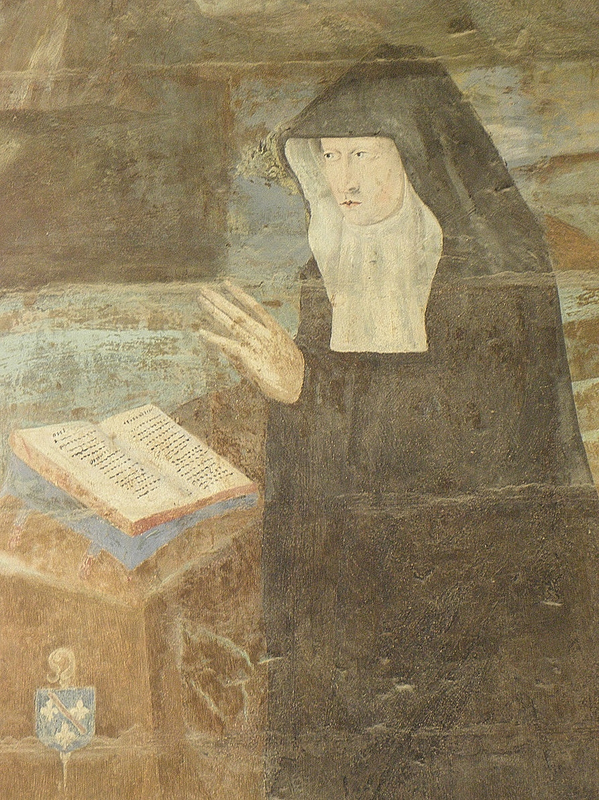

+++
title = "Isabelle IV de Bourbon-Vendôme"
summary = "Thomas Pot"
read_more_copy = "Voir la fiche"
categories = ["Bénédictines", "Fontevristes", "Supérieure", "XVIe siècle"]
index = ["Isabelle IV de Bourbon-Vendôme", "Thomas Pot", "Jésus Christ", "Vierge Marie", "Saint Jean", "Sainte Marie-Madeleine"]
+++

**Titre** : Isabelle IV de Bourbon-Vendôme

**Auteur principal** : [Thomas Pot](index:Thomas-Pot)

**Profession** : Peintre

**Date d'exécution** : Vers 1563

**Lieu d'exécution** : Salle capitulaire de  l'abbaye de Fontevraud, à droite dans la fresque de la descente de croix.

**Matériaux/Techniques** : Peinture à fresque

**Lieu de conservation actuel** : Salle capitulaire de l'abbaye de Fontevraud

**Lieu de séjour/d'exposition initial** : Salle capitulaire de l'abbaye de Fontevraud

**Ordre** : Bénédictin

**Congrégation** : Fontevriste

**Nom du ou des monastères d'exercice** : Abbaye de Fontevraud ; Abbaye aux Dames de Caen

**Nom de la religieuse** : [Isabelle IV de Bourbon-Vendôme](index:Isabelle-IV-de-Bourbon-Vendôme)

**Statut de la religieuse** : Abbesse

**Autres personnages religieux** : [Jésus Christ](index:Jésus-Christ) ; [Vierge Marie](index:Vierge-Marie) ; [sainte Marie-Madeleine](index:Sainte-Marie-Madeleine) ; [saint Jean](index:Saint-Jean)

**Commentaires** : Isabelle ou Isabeau de Bourbon (1475-1531), est d'abord grande prieure de Fontevraud puis abbesse de la Trinité de Caen de 1505 à 1531. Il s'agit de la sœur de Renée de Bourbon, abbesse de Fontevraud.

**Crédits photographiques** : Lydie Brunetti

