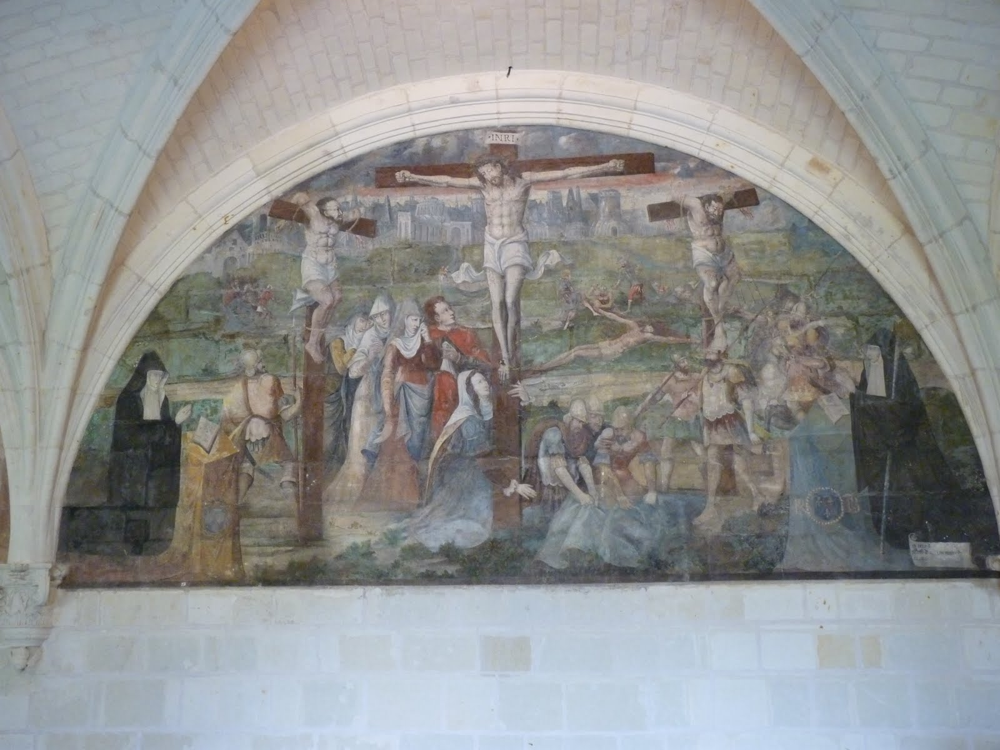

+++
title = "Renée de Bourbon"
summary = "Thomas Pot "
read_more_copy = "Voir la fiche"
categories = ["Bénédictines", "Fontevristes", "Supérieure", "XVIe siècle"]
index = ["Thomas Pot", "Renée de Bourbon", "Jésus Christ", "Vierge Marie", "Saint Jean", "Sainte Marie-Madeleine"]
+++

**Titre** : Renée de Bourbon

**Auteur principal** : [Thomas Pot](index:Thomas-Pot) 

**Profession** : Peintre 

**Date d'exécution** : Vers 1563

**Lieu d'exécution** : Salle capitulaire de l'abbaye de Fontevraud, à droite dans la fresque de la Crucifixion

**Matériaux/Techniques** : Peinture à fresque

**Lieu de conservation actuel** : Salle capitulaire de Fontevraud 

**Lieu de séjour/d'exposition initial** : Salle capitulaire de l'abbaye de Fontevraud

**Ordre** : Bénédictin 

**Congrégation** : Fontevriste

**Nom du ou des monastères d'exercice** : Abbaye aux Dames de Caen ; Abbaye de Fontevraud

**Nom de la religieuse** : [Renée de Bourbon](index:Renée-de-Bourbon)

**Statut de la religieuse** : Abbesse

**Autres personnages religieux** : [Jésus Christ](index:Jésus-Christ) ; [Vierge Marie](index:Vierge-Marie) ; [sainte Marie-Madeleine](index:Sainte-Marie-Madeleine) ; [saint Jean](index:Saint-Jean)

**Commentaires** : Renée de Bourbon (1468-1534), abbesse de la Trinité de Caen puis abbesse de Fontevraud de 1491 à 1534. Elle s'attache à diffuser le plus largement possible la réforme initiée par Marie de Bretagne.

**Crédits photographiques** : Lydie Brunetti

**Biographie** :  [Renée de Bourbon, abbesse de Fontevraud]()

