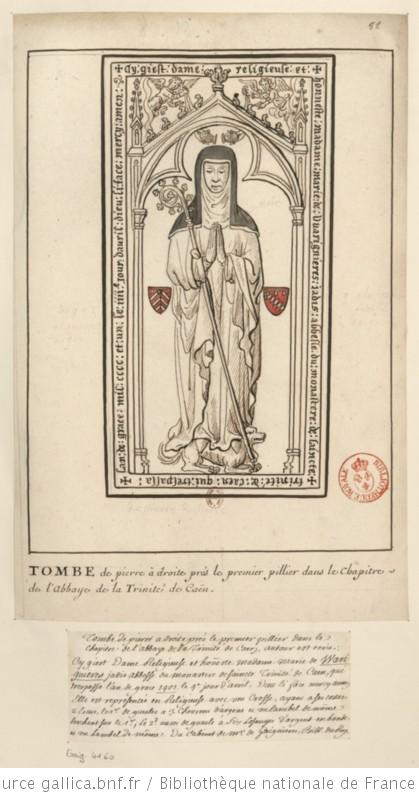

+++
title = "Dessin de la pierre tombale de Marie de Varignières"
summary = "François Roger de Gaignières "
read_more_copy = "Voir la fiche"
categories = ["Bénédictines", "Supérieure", "XVIIe siècle", "XVIIIe siècle"]
index = ["Marie de Varignières", "François Roger de Gaignières"]
+++

**Titre** : Dessin de la pierre tombale de Marie de Varignières

**Auteur principal** : [François Roger de Gaignières](index:François-Roger-de-Gaignières) 

**Profession** : Erudit ; collectionneur 

**Renseignements biographiques** : 1642 - 1715

**Date d'exécution** : Entre 1687 et 1715

**Lieu d'exécution** : France

**Matériaux/Techniques** : Dessin lavé

**Lieu de conservation actuel** : Bibliothèque nationale de France, N° d'inventaire : Est. RESERVE Pe-8-Fol.

**Série** : Fait partie d'un ensemble de dessins de pierres tombales récollées par ou pour François Roger de Gaignières.

**Document original** : Dalle funéraire du début du XVe siècle.

**Ordre** : Bénédictin

**Nom du ou des monastères d'exercice** : Abbaye aux Dames de Caen

**Nom de la religieuse** : [Marie de Varignières](index:Marie-de-Varignières)

**Statut de la religieuse** : Abbesse

**Texte dans l'image** : Ci giest Dame Religieuse et honeste Madame Marie de Warignières jadis abbesse au monastère de sainte Trinité de Caen, qui trespassa l’an de grâce 1401, le 4ème jour d’avril, Dieu lui fasse merci assez

**Paratexte** : "Tombe de pierre à droite près le premier pilier dans le chapitre de l’Abbaye de la Trinité de Caen"
"Autour est écrit : Ci giest Dame Religieuse et honeste Madame Marie de Warignières jadis abbesse au monastère de sainte Trinité de Caen, qui trespassa l’an de grâce 1401, le 4ème jour d’avril, Dieu lui fasse merci assez. Elle est représentée en Religieuse avec une crosse ayant à ses costés deux Ecus, le 1er de gueules à trois chevrons d’argens en un lambel de même brochant sur le 1er, le 2ème aussi de gueule à six losanges d’argent en bande et un lambel de même. Du Cabinet de Mr de Gaignières, Bibl. du Roy."

**Auteur des textes** : François Roger de Gaignières

**Commentaires** : La dalle funéraire copiée se trouve dans la salle capitulaire de l'abbaye de la Trinité de Caen.

**Crédits photographiques** : Bibliothèque Nationale de France

**Références bibliographiques** : BOUCHOT Henri, _Inventaire des dessins exécutés pour Roger de Gaignières et conservés aux départements des estampes et des manuscrits_, Paris, 1891, n°4160.

