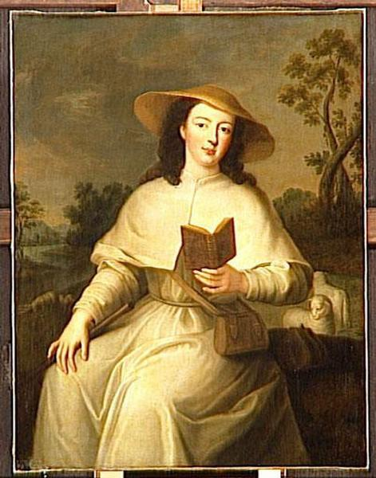

+++
title = "Louise-Adélaïde d'Orléans ; Mademoiselle de Chartres "
summary = "Auteur anonyme"
read_more_copy = "Voir la fiche"
categories = ["Bénédictines", "Supérieure", "XVIIIe siècle"]
index = ["Louise-Adélaïde d'Orléans"]
+++

**Titre** : Louise-Adélaïde d'Orléans ; Mademoiselle de Chartres 

**Auteur principal** : Auteur anonyme

**Profession** : Peintre

**Auteurs secondaires** : D'après Jean-Baptiste Santerre 

**Profession** : Peintre

**Renseignements biographiques** : 1658 - 1717

**Date d'exécution** : Vers 1725

**Lieu d'exécution** : France

**Matériaux/Techniques** : Peinture huile sur toile

**Dimensions** : 115 x 89 cm

**Lieu de conservation actuel** : Musée national des châteaux de Versailles et de Trianon. Numéro d'inventaire : MV 3726 ; INV 7842 ; LP 3632 .

**Inspiration artistique** : Copie d'un tableau de Jean-Baptiste Santerre.

**Ordre** : Bénédictin

**Nom du ou des monastères d'exercice** : Abbaye Notre-Dame de Chelles

**Nom de la religieuse** : [Louise-Adélaïde d'Orléans](index:Louise-Adélaïde-d'Orléans)

**Statut de la religieuse** : Abbesse

**Commentaires** : Louise-Adélaïde d'Orléans (1698-1743) est assise en costume de bergère, lisant et gardant des moutons. Elle est ici représentée avant son accession à l'abbatiat. 

Ancien propriétaire : Christy.  Acquis en 1838. 

**Crédits photographiques** : © Gérard Blot ; Réunion des musées nationaux. Cote cliché : 98-001627.

**Références bibliographiques** : SOULIE Eudore, _Notice du musée national de Versailles, 1re partie : rez-de-chaussée_, Paris, C. de Mourgues frères, 1880 (3e éd.), n° 3726. 

CONSTANS Claire, _Musée national du château de Versailles, catalogue des peintures_, Paris, 1980, n° 5861.

**Biographie** : [Louise-Adélaïde d'Orléans]()
