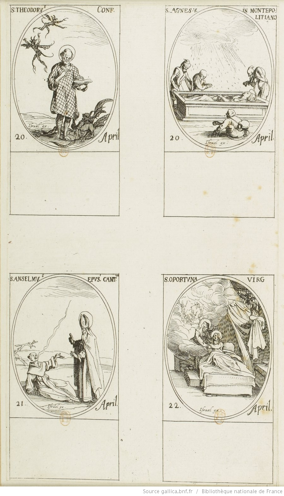

+++
title = "Planche de saints avec sainte Opportune"
summary = "Jacques Callot"
read_more_copy = "Voir la fiche"
categories = ["Bénédicines", "Fondatrice", "XVIIe siècle"]
index = ["Sainte Opportune d'Almenèches", "Jacques Callot"]
+++

**Titre** : Planche de saints avec sainte Opportune

**Auteur principal** : [Jacques Callot](index:Jacques-Callot) 
 
**Profession** : Dessinateur 

**Renseignements biographiques** : 1592 - 1635

**Auteurs secondaires** : Israël Henriet

**Profession** : Editeur

**Renseignements biographiques** : 1590 ? - 1661

**Date d'exécution** : 1636

**Lieu d'exécution** : Paris

**Matériaux/Techniques** : Estampe à l'eau-forte

**Dimensions** : 20 x 12 cm

**Lieu de conservation actuel** : Bibliothèque nationale de France, Richelieu - Estampes et photographie - magasin de la Réserve RESERVE ED- 25 (16) -BOITE ECU.

**Ouvrage imprimé ou manuscrit** : Fait partie du recueil _Œuvre de Jacques Callot. Œuvre de Réserve_, pièce 644.

**Série** : Série des "Images des saints", de Jacques Callot, trente-troisième planche. Deuxième état, édition posthume.

**Ordre** : Bénédictin

**Nom du ou des monastères d'exercice** : Abbaye d'Almenèches

**Nom de la religieuse** : [Sainte Opportune d'Almenèches](index:Sainte-Opportune-d'Almenèches)

**Statut de la religieuse** : Abbesse ; fondatrice du monastère 

**Autres personnages religieux** : Saint Théodore, confesseur ; sainte Agnès de Montepulciano ; Saint Anselme, évêque de Cantorbéry

**Texte dans l'image** : S. OPORTUNA (en haut à gauche). VIRG (en haut à droite). 22 April (en bas). Israël ex (en dessous du lit).

**Paratexte** : Sur les autres vignettes : "S. THEODORV.S CONF. 20 April" 
"S. AGNES. V. IN MONTEPO : // LITIANO 20. April." 
"S. ANSELMV.S EPVS. CANT.VA 21. April."

**Auteur des textes** : Jacques Callot

**Traduction des textes** : Sainte Opportune / Vierge / 22 avril / Israël, libraire diffuseur.

**Auteur de la traduction** : Lydie Brunetti

**Commentaires** : Les autres saints sont Saint Théodore, confesseur, sainte Agnès de Montepulciano et Saint Anselme, évêque de Cantorbéry.

**Crédits photographiques** : Bibliothèque Nationale de France

**Références bibliographiques** : MEAUME Edouard, _Recherches sur la vie et les ouvrages de Jacques Callot suite au Peintre-graveur français de M. Robert-Dumesnil_, Paris, 1860, n° 336.

LIEURE J., _Jacques Callot : catalogue raisonné de l'oeuvre gravé_, Paris, 1924-1929, Callot n° 936-939.

WEIGERT Roger-Armand, _Inventaire du fonds français, graveurs du XVIIe siècle_, Tome II, _Boulanger (Jean) - Chauveau (François)_, Paris, Bibliothèque nationale, 1951, Callot n° 936-939.

**Biographie** : [Sainte Opportune d'Almenèches]()

