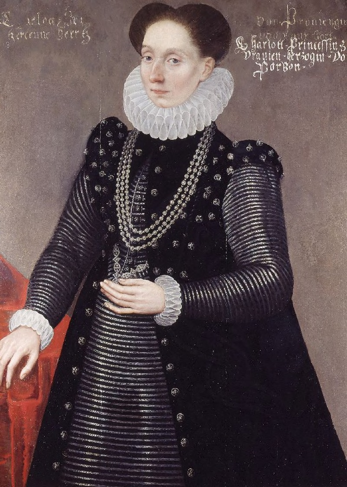

+++
title = "Charlotte de Bourbon"
summary = "Attribué à Daniël van den Queborn "
read_more_copy = "Voir la fiche"
categories = ["Bénédictines", "Supérieure", "XVIe siècle"]
index = ["Charlotte de Bourbon-Montpensier"]
+++

**Titre** : Charlotte de Bourbon

**Auteur principal** : Attribué à Daniël van den Queborn 

**Profession** : Peintre

**Renseignements biographiques** : Vers 1577 - 1602

**Date d'exécution** : Vers 1579

**Lieu d'exécution** : Pays-Bas (Anvers ?)

**Matériaux/Techniques** : Peinture huile sur panneau

**Dimensions** : 104 x 73 cm

**Lieu de conservation actuel** : House of Orange-Nassau Historic Collections Trust, La Haye, Pays-Bas, numéro d’inventaire 175. (Collection de la famille royale de Hollande)

**Ordre** : Bénédictin

**Nom du ou des monastères d'exercice** : Abbaye Notre-Dame de Jouarre

**Nom de la religieuse** : [Charlotte de Bourbon-Montpensier](index:Charlotte-de-Bourbon-Montpensier)

**Statut de la religieuse 1** : Abbesse

**Texte dans l'image** : Charlotte princessin / herzogin Von / Bourbon

**Paratexte** : 

**Auteur des textes** : 

**Traduction des textes** : La princesse Charlotte, duchesse de Bourbon

**Auteur de la traduction** : Lydie Brunetti

**Commentaires** : Abbesse de Notre-Dame de Jouarre de 1555 à 1572, Charlotte de Bourbon-Montpensier se convertit au protestantisme puis fuit son couvent avant de se marier au prince Guillaume 1er d'Orange-Nassau.
Portrait commandé par Günther XLI, Comte de Schwarzburg (1529-1583).
Catherine de Nassau (1543-1624) en hérite en 1583.
Catherine Belgica, princesse d'Orange (1578-1648), en hérite en 1624. 
Wilhelm V., Landgraf von Hessen-Kassel (1602-1637), en hérite à une date inconnue.

**Crédits photographiques** : RKD Netherlands Institute for Art History  

**Biographie** : [Charlotte de Bourbon-Montpensier]()

