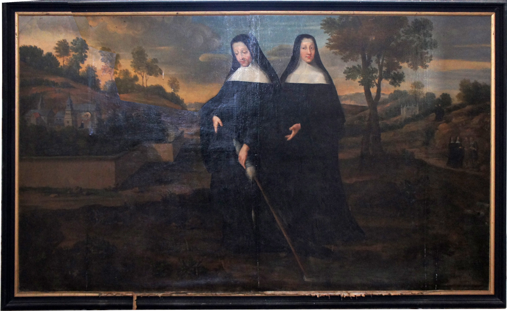

+++
title = "La fondation de l'abbaye par sainte Berthe"
summary = "Attribué à Jean Hellart "
read_more_copy = "Voir la fiche"
categories = ["Bénédictines", "Fondatrice", "Supérieure", "XVIIe siècle"]
index = ["Sainte Berthe d'Avenay", "Marie-Eléonore Brulart de Sillery"]
+++

**Titre** : La fondation de l'abbaye par sainte Berthe

**Auteur principal** : Attribué à Jean Hellart 

**Profession** : Peintre 

**Renseignements biographiques** : 1618 - 1685

**Date d'exécution** : Entre 1666 et 1687

**Lieu d'exécution** : Avenay

**Matériaux/Techniques** : Peinture sur toile

**Lieu de conservation actuel** : Eglise d'Avenay-Val-d'Or, Marne, Champagne-Ardennes.

**Lieu de séjour/d'exposition initial** : Chœur de l'église de l'abbaye d'Avenay

**Ordre** : Bénédictin

**Nom du ou des monastères d'exercice** : Abbaye d'Avenay

**Nom de la religieuse 1** : [Sainte Berthe d'Avenay](index:Sainte-Berthe-d'Avenay) 

**Statut de la religieuse 1** : Fondatrice du monastère ; première abbesse

**Nom de la religieuse 2** : [Marie-Eléonore Brulart de Sillery](index:Marie-Eléonore-Brulart-de-Sillery)

**Statut de la religieuse 2** : Abbesse

**Commentaires** : Le tableau a été commandé par l'abbesse Marie-Eléonore Brulart de Sillery.
Au IXème siècle, le domaine sur lequel était situé la source, appartenait aux archevêques de Reims. La source sacrée fut baptisée du nom de la sainte. Les anciennes croyances et pratiques cultuelles furent transformées en pèlerinage. L’oratoire devint une chapelle.
Peinture classée monument historique le 02/06/1954. 
Propriété de la commune.  

**Crédits photographiques** : Gérald Garitan

**Références bibliographiques** : ANTOINE Louis, _Histoire de l'abbaye d'Avenay_, Paris, 1879, p.455-456.

**Biographie** : [Sainte Berthe d'Avenay]() 
