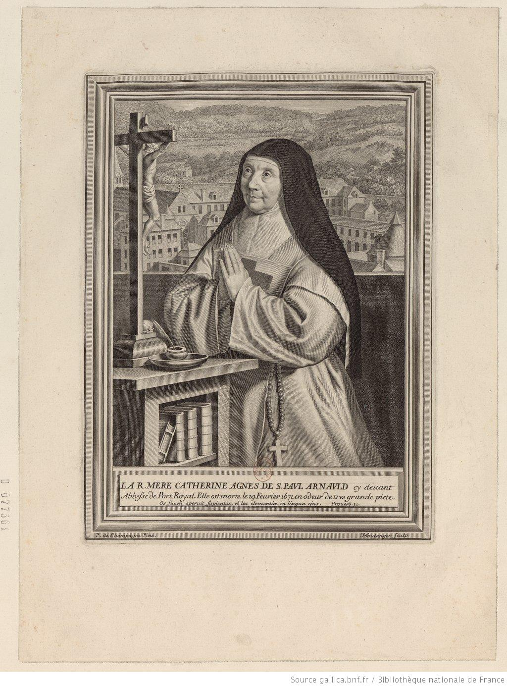

+++
title = "Mère Catherine Agnès de Saint-Paul Arnauld, abbesse de Port-Royal des Champs."
summary = "Jean Boulanger "
read_more_copy = "Voir la fiche"
categories = ["Cisterciennes", "Supérieure", "XVIIe siècle"]
index = ["Agnès de Saint-Paul Arnauld", "Jean Boulanger", "Philippe de Champaigne"]
+++

**Titre** : Mère Catherine Agnès de Saint-Paul Arnauld, abbesse de Port-Royal des Champs

**Auteur principal** : [Jean Boulanger](index:Jean-Boulanger) 

**Profession** : Graveur

**Renseignements biographiques** : Troyes 1606 - Paris 1680

**Auteurs secondaires** : Gautrot

**Profession** : Editeur

**Date d'exécution** : XVIIe siècle

**Lieu d'exécution** : Paris

**Matériaux/Techniques** : Estampe. Eau-forte et burin sur papier vergé

**Dimensions** : 31 x 22 cm

**Lieu de conservation actuel** : Bibliothèque Nationale de France : Richelieu, département Estampes et photographie, N-2 (ARNAULD, Catherine Agnès de Saint-Paul). 

**Autres exemplaires** : Autre exemplaire au musée de Port-Royal des Champs, Magny-les-Hameaux. Numéro d'inventaire : PRG415-37. 
Autre exemplaire au musée des beaux-arts et d'archéologie de Châlons-en-Champagne (Musée de France, propriété de la commune). Numéro d’inventaire : 926.5.4 ; 2239 (Registre des entrées (1865-1969)).
Autre exemplaire au Centre de recherche du château de Versailles, N°identification : INV.GRAV.LP 36.101.1.

**Inspiration artistique** : D'après le tableau de [Philippe de Champaigne](index:Philippe-de-Champaigne) 

**Autre lieu d'exposition** : Collection Gailleur

**Ordre** : Cistercien

**Nom du ou des monastères d'exercice** : Abbaye de Port-Royal des Champs

**Nom de la religieuse** : [Agnès de Saint-Paul Arnauld](index:Agnès-de-Saint-Paul-Arnauld)

**Statut de la religieuse** : Abbesse

**Texte dans l'image** : LA R. MERE CATHERINE AGNES DE S.PAUL ARNAULD cy devant / Abbesse de Port Royal. Elle est morte le 19 Fevrier 1671 en odeur de tres grande piete. / _Os, fuum aperuit fapientio, et lex clementio in lingua ejus.__ Proverb.31.

**Paratexte** : Signature, en bas à droite : "Iboulanger Sculp." 
Signature, en bas à gauche : "P. de Champagne Pinx."

**Traduction des textes** : "Elle a ouvert sa bouche à la sagesse, et la loi de la clémence est sur sa langue" (Proverbes, chap.31:26)

**Crédits photographiques** : Gallica - Bibliothèque Nationale de France

**Biographie** : [Agnès de Saint-Paul Arnauld]() 

