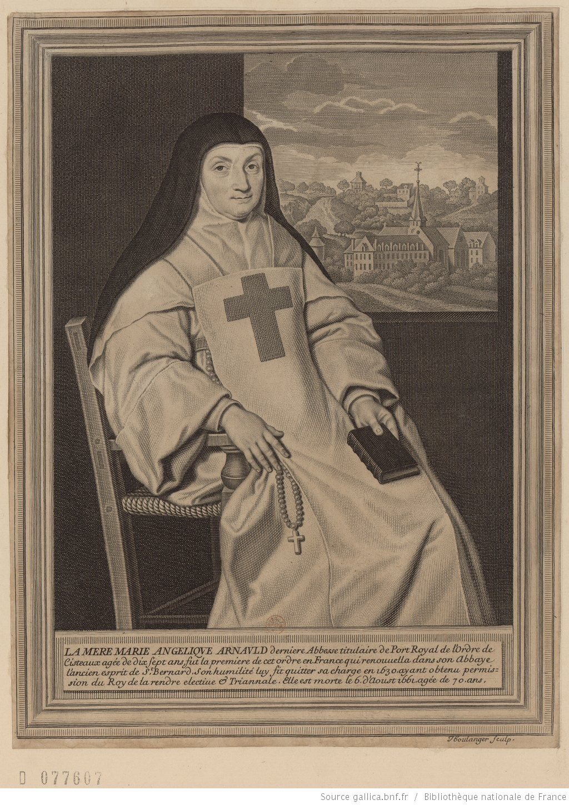

+++
title = "Mère Marie Angélique Arnauld, abbesse de Port-Royal des Champs."
summary = "Jean Boulanger "
read_more_copy = "Voir la fiche"
categories = ["Cisterciennes", "Supérieure", "XVIIe siècle"]
index = ["Angélique-Marie de Sainte-Madeleine Arnauld", "Jean Boulanger", "Philippe de Champaigne"]
+++

**Titre** : Mère Marie Angélique Arnauld, abbesse de Port-Royal des Champs

**Auteur principal** : [Jean Boulanger](index:Jean-Boulanger) 

**Profession** : Graveur

**Renseignements biographiques** : Troyes 1606 - Paris 1680

**Auteurs secondaires** : D'après [Philippe de Champaigne](index:Philippe-de-Champaigne) 

**Profession** : Peintre

**Renseignements biographiques** : 1602 - 1674

**Date d'exécution** : XVIIe siècle

**Lieu d'exécution** : Paris

**Matériaux/Techniques** : Estampe. Eau-forte et burin sur papier vergé

**Dimensions** : 25,7 x 18,9 cm

**Lieu de conservation actuel** : Bibliothèque nationale de France, département Estampes et photographie, N-2 (ARNAULD, Marie Angélique), N°077607.

**Autres exemplaires** : Autre exemplaire au musée des beaux-arts et d'archéologie de Châlons-en-Champagne (Musée de France, propriété de la commune). Numéro d’inventaire : 926.5.2 ; 2239 (Registre des entrées (1865-1969)).

**Inspiration artistique** : D'après le tableau de Philippe de Champaigne 

**Autre lieu d'exposition** : Collection Gailleur

**Ordre** : Cistercien 

**Nom du ou des monastères d'exercice** : Abbaye de Port-Royal des Champs

**Nom de la religieuse** : [Angélique-Marie de Sainte-Madeleine Arnauld](index:Angélique-Marie-de-Sainte-Madeleine-Arnauld) 

**Statut de la religieuse** : Abbesse

**Texte dans l'image** : "LA MERE MARIE ANGELIQUE ARNAULD derniere Abbesse titulaire de Port Royal de l'Ordre de / Cisteaux agée de dix sept ans, fut la premiere de cet ordre en France qui renouvella dans son Abbaye / l'ancien esprit de St. Bernard. Son humilité luy fit quitter sa charge en 1630, ayant obtenu permis / sion du Roy de la rendre elective Triannale. Elle est morte le 6 d'Aoust 1661, agée de 70 ans."

**Paratexte** : Signature, en bas à droite : "Iboulanger sculp."

**Crédits photographiques** : Gallica - Bibliothèque nationale de France

**Biographie** : [Angélique-Marie de Sainte-Madeleine Arnauld]()

