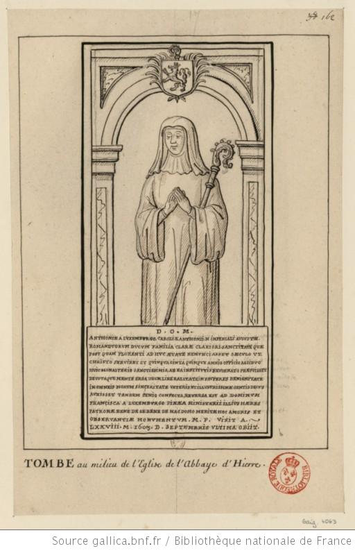

+++
title = "Dessin de la pierre tombale d'Antoinette de Luxembourg-Ligny"
summary = "François Roger de Gaignières "
read_more_copy = "Voir la fiche"
categories = ["Bénédictines", "Supérieure", "XVIIe siècle", "XVIIIe siècle"]
index = ["Antoinette de Luxembourg-Ligny", "François Roger de Gaignières"]
+++

**Titre** : Dessin de la pierre tombale d'Antoinette de Luxembourg-Ligny

**Auteur principal** : [François Roger de Gaignières](index:François-Roger-de-Gaignières) 

**Profession** : Erudit ; collectionneur 

**Renseignements biographiques** : 1642 - 1715

**Date d'exécution** : Entre 1687 et 1715.

**Lieu d'exécution** : France

**Matériaux/Techniques** : Dessin à la plume.

**Lieu de conservation actuel** : Bibliothèque nationale de France, N° d'inventaire : Est. RESERVE Pe-5-Fol.

**Série** : Fait partie d'un ensemble de dessins de pierres tombales récollées par ou pour François Roger de Gaignières.

**Document original** : Dalle funéraire du début du XVIIe siècle.

**Ordre** : Bénédictin

**Nom du ou des monastères d'exercice** : Abbaye Notre-Dame d'Yerres

**Nom de la religieuse** : [Antoinette de Luxembourg-Ligny](index:Antoinette-de-Luxembourg-Ligny)

**Statut de la religieuse** : Abbesse 

**Texte dans l'image** : D . O . M . / ANTHONIAE A LUXEMBURGO, CAROLI – E – ANTHONII – N – IMPERIALI AUGUSTAE. / ROMAN DUORUM DUCUM FAMILIA CLARAE CLARIORI SANCTITATE QUAE / POST QUAM FLORENTI AD HUC AETATE RENUNCIASSET SAECULO UT / CHRISTO SERVIRET ET QUINQUA GINTA QUINQUE ANNIS OFFICIO ASSIDUO / HUIC MONASTERIO SANCTISSIMIS, AB EA INSTITUTIS REFORMATO PRAEFUISSET / DEVOTAQUE MENTE ERGA DEUM, LIBERALITATE IN PAUPERES, BENIGNITATE / IN OMNEIS MORUM SINCERITATE VETERIS ET ILLUSTRISSIMAE GENTIS DECUS / AUXISSET TANDEM SENIO CONFECTA, REVERSA EST AD DOMINUM / FRANCISCA A LUXEMBURGO PINAEA MINISTERII ILLIUS HAERES/ PATRONAE BENE DE SE BENE DE HAC DOMO MERITAE HOC AMORIS ET/ OBSERVANTIAE MONUMENTUM. M . P . VIXIT A. / LXXVIII – M – 1603 . D . SEPTEMBRIS ULTIMA OBIIT.

**Paratexte** : Tombe au milieu de l'Eglise de l'abbaye d'Hierre.

**Traduction des textes** : Antoinette de Luxembourg, (Charles -E- Antoine-N-Empereur Auguste ?).  De la très illustre et sainte famille ducale (romaine ?), après qu'à la fleur de l'âge, elle eut renoncé au siècle pour servir le Christ et après cinquante-cinq années très saintes d'un service assidu pour ce monastère, dont elle a institué et dirigé la réforme, l'esprit, grâce à Dieu, dévoué à la bonté, à la générosité envers les pauvres, à la sincérité dans toutes ses actions, elle a augmenté l'honneur de son ancienne et très illustre famille, enfin affaiblie par son grand âge, elle revint à Dieu.
Françoise de Luxembourg, héritière de cette fonction, à sa protectrice,  pour elle-même et pour sa maison, qui a mérité ce monument d'amour et de considération. Elle a vécu 78 ans et est morte le dernier jour de septembre 1603.

**Auteur de la traduction** : Lydie Brunetti

**Commentaires** : Abbesse de l'abbaye Notre-Dame d'Yerres de 1553 à 1603. La tombe se trouve dans l'église de l'abbaye Notre-Dame d'Yerres.

**Crédits photographiques** : Gallica - Bibliothèque Nationale de France

**Références bibliographiques** : BOUCHOT Henri, _Inventaire des dessins exécutés pour Roger de Gaignières et conservés aux départements des estampes et des manuscrits_, Paris, 1891, 4063.

