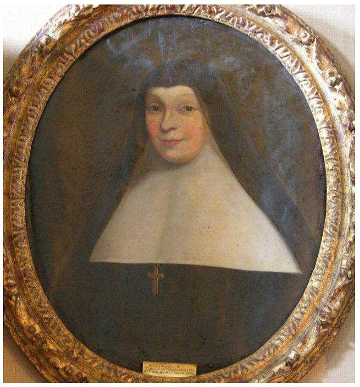

+++
title = "Françoise II de Foix, abbesse de Notre-Dame de Saintes"
summary = "Auteur anonyme"
read_more_copy = "Voir la fiche"
categories = ["Bénédictines", "Supérieure", "XVIIe siècle"]
index = ["Françoise de Foix II"]
+++

**Titre** : Françoise II de Foix, abbesse de Notre-Dame de Saintes

**Auteur principal** : Auteur anonyme

**Profession** : Peintre

**Date d'exécution** : Entre 1606 et 1666

**Lieu d'exécution** : Saintonge

**Matériaux/Techniques** : Peinture huile sur toile.

**Lieu de conservation actuel** : Musée Dupuy-Mestreau, Saintes 

**Lieu de séjour/d'exposition initial** : Abbaye Notre-Dame de Saintes 

**Ordre** : Bénédictin

**Nom du ou des monastères d'exercice** : Abbaye Notre-Dame de Saintes

**Nom de la religieuse** : [Françoise de Foix II](index:Françoise-de-Foix-II)

**Statut de la religieuse** : Abbesse

**Commentaires** : Abbesse de Notre-Dame de Saintes de 1606 à 1666. Aussi appelée de Foix-Gurson.

**Crédits photographiques** : Pierre Collenot (musée Dupuy-Mestreau)

**Références bibliographiques** : TISSOT Allan, _Une abbaye de renom à l'époque moderne : l'Abbaye aux Dames de Saintes (fin du XVe siècle - début XIXe siècle)_, Thèse, Bordeaux, Université Michel de Montaigne, 2012.

**Biographie** : [Françoise de Foix II]()

