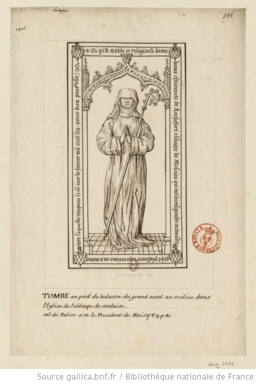

+++
title = "Dessin de la pierre tombale d'Etiennette de Rochefort"
summary = "François Roger de Gaignières "
read_more_copy = "Voir la fiche"
categories = ["Cisterciennes", "Supérieure", "XVIIe siècle", "XVIIIe siècle"]
index = ["Etiennette de Rochefort", "François Roger de Gaignières"]
+++

**Titre** : Dessin de la pierre tombale d'Etiennette de Rochefort

**Auteur principal** : [François Roger de Gaignières](index:François-Roger-de-Gaignières)  

**Profession** : Erudit ; collectionneur 

**Renseignements biographiques** : 1642 - 1715

**Date d'exécution** : Entre 1687 et 1715

**Lieu d'exécution** : France

**Matériaux/Techniques** : Dessin à la plume

**Lieu de conservation actuel** : Bibliothèque nationale de France, n° d'inventaire : Est. RESERVE Pe-4-Fol.

**Série** : Fait partie d'un ensemble de dessins de pierres tombales récollées par ou pour François Roger de Gaignières.

**Document original** : Dalle funéraire de la deuxième moité du XVe siècle.

**Ordre** : Cistercien

**Nom du ou des monastères d'exercice** : Abbaye de Molaise

**Nom de la religieuse** : [Etiennette de Rochefort](index:Etiennette-de-Rochefort)

**Statut de la religieuse** : Abbesse

**Texte dans l'image** : Ci gist noble et religieuse dame Étiennette de Rochefort, abbesse de Molaise qui mit les religieuses en couvent et fit plusieurs réparations en ce monastère laquelle trespassa le IIIème jour de février CCCC-LIX (1459), pries Dieu pour elle.

**Paratexte** : Tombe au pied du balustre du grand autel au milieu dans l’Eglise de l’abbaye de Molaise

**Auteur des textes** : François Roger de Gaignières

**Commentaires** : La dalle funéraire copiée se trouve dans l'église de l'abbaye de Molaise. Les armes sont celles de Rochefort.

**Crédits photographiques** : Gallica - Bibliothèque Nationale de France

**Références bibliographiques** : BOUCHOT Henri, _Inventaire des dessins exécutés pour Roger de Gaignières et conservés aux départements des estampes et des manuscrits_, Paris, 1891, t. 2, n°3955.

