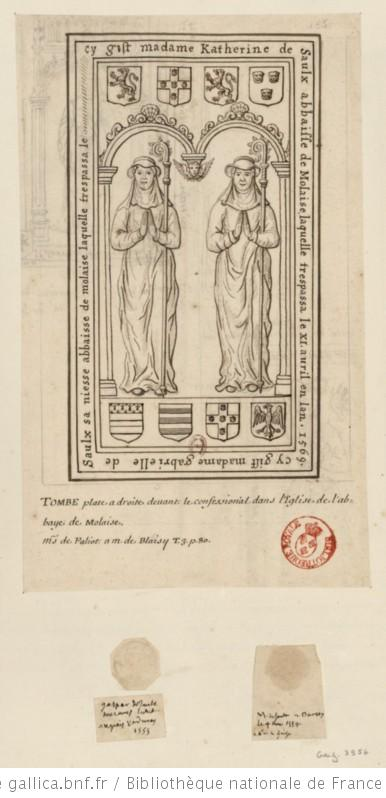

+++
title = "Dessin de la pierre tombale de Catherine et Gabrielle de Saulx"
summary = "François Roger de Gaignières "
read_more_copy = "Voir la fiche"
categories = ["Cisterciennes", "Supérieure", "XVIIe siècle", "XVIIIe siècle"]
index = ["Catherine de Saulx-Tavannes", "Gabrielle de Saulx-Tavannes", "François Roger de Gaignières"]
+++

**Titre** : Dessin de la pierre tombale de Catherine et Gabrielle de Saulx

**Auteur principal** : [François Roger de Gaignières](index:François-Roger-de-Gaignières) 

**Profession** : Erudit ; collectionneur

**Renseignements biographiques** : 1642 - 1715

**Date d'exécution** : Entre 1687 et 1715 

**Lieu d'exécution** : France

**Matériaux/Techniques** : Dessin à la plume

**Lieu de conservation actuel** : Bibliothèque nationale de France, n° d'inventaire : Est. RESERVE Pe-4-Fol.  

**Série** : Fait partie d'un ensemble de dessins de pierres tombales récollées par ou pour François Roger de Gaignières.

**Document original** : Pierre tombale en calcaire beige avec effigies des défuntes gravées sous arcades avec quatre écus armoriés en haut et en bas ; sur le pourtour, épitaphe en lettres gothiques.  195 x 93 cm. 2e moitié du XVIe siècle

**Ordre** : Cistercien

**Nom du ou des monastères d'exercice** : Abbaye de Molaise

**Nom de la religieuse 1** : [Catherine de Saulx-Tavannes](index:Catherine-de-Saulx-Tavannes) 

**Statut de la religieuse 1** : Abbesse

**Nom de la religieuse 2** : [Gabrielle de Saulx-Tavannes](index:Gabrielle-de-Saulx-Tavannes)

**Statut de la religieuse 2** : Abbesse

**Texte dans l'image** : Cy gist madame Katherine de Saulx abbaisse de Molaise laquelle trespassa le XI avril en l’an 1569. Cy gist madame Gabrielle de Saulx sa niesse abbaisse de Molaise laquelle trespassa le [lacune].

**Paratexte** : TOMBE plate à droite devant le confessionnal dans l’Eglise de l’abbaye de Molaise. Ms de Paliot a M. de Blaisy T3 p80.        
Armes : 1° un lion rampant, qui est Saulx ; 2° une croix chargée de cinq coquilles ; 3° un lion rampant ; 4° trois têtes de léopards ; 5° un fascé au chef d'hermines ; 6° six cottices ; 7° une croix chargée de cinq coquilles ; 8° un aigle éployé. 
Au dessous du dessin se trouvent deux sceaux originaux sur papier aux armes des de Saulx.

**Auteur des textes** : François Roger de Gaignières

**Commentaires** : Les deux abbesses Catherine et Gabrielle de Saulx sont représentées mains jointes avec leur crosse abbatiale et les armoiries de leurs familles ; une tête d'angelot sépare les deux arcades. Il s'agit d'une tante et de sa nièce.

La dalle funéraire est conservée à l'église paroissiale Saint-Cyr-et-sainte-Julitte, rue de l'Eglise, Ecuelles, Saône-et-Loire, Bourgogne (propriété de la commune). Notice Palissy IM71000930. 

**Crédits photographiques** : Gallica - Bibliothèque Nationale de France

**Références bibliographiques** : BOUCHOT Henri, _Inventaire des dessins exécutés pour Roger de Gaignières et conservés aux départements des estampes et des manuscrits_, Paris, 1891, t. 2, n°3956.   

Notice Palissy : Elisabeth Réveillon et Brigitte Fromaget

