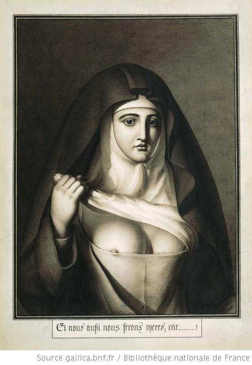

+++
title = "Et nous aussi nous serons mères; car ....... !"
summary = "Jean-Jacques Lequeu "
read_more_copy = "Voir la fiche"
categories = ["Simple moniale", "XVIIIe siècle"]
index = ["Jean-Jacques Lequeu"]
+++

**Titre** : Et nous aussi nous serons mères; car ....... !

**Auteur principal** : [Jean-Jacques Lequeu](index:Jean-Jacques-Lequeu) 

**Profession** : Dessinateur ; architecte 

**Renseignements biographiques** : 1757 - 1826

**Date d'exécution** : 1794

**Lieu d'exécution** : France

**Matériaux/Techniques** : Dessin à la plume et lavis

**Dimensions** : 50 x 36,4 cm

**Lieu de conservation actuel** : Bibliothèque nationale de France, Département Estampes et photographie, EST RESERVE HA-80 (B, 7)

**Ordre** : Non identifié

**Nom de la religieuse** : Religieuse anonyme

**Statut de la religieuse** : Simple moniale

**Texte dans l'image** : Et nous aussi nous serons mères; car ...... !

**Commentaires** : Dessin de propagande révolutionnaire :  les religieuses sont des femmes comme les autres, n'ont rien de sacré et doivent mener une existence "normale", c'est-à-dire, d'après les doctrines révolutionnaires, d'épouse et de mère. 
Le dessin recoupe aussi certains fantasmes par rapport à  la sexualité des religieuses.
Le dessinateur a produit de nombreuses images érotiques.

**Crédits photographiques** : Gallica - Bibliothèque Nationale de France

