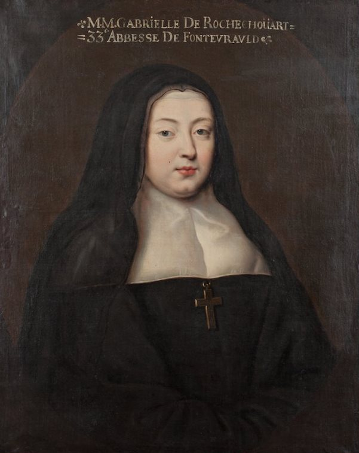

+++
title = "Marie-Madeleine-Gabrielle de Rochechouart de Mortemart, abbesse de Fontevraud"
summary = "Auteur anonyme"
read_more_copy = "Voir la fiche"
categories = ["Fontevristes", "Supérieure", "XVIIe siècle"]
index = ["Marie-Madeleine-Gabrielle de Rochechouart de Mortemart"]
+++

**Titre** : Marie-Madeleine-Gabrielle de Rochechouart de Mortemart, abbesse de Fontevraud

**Auteur principal** : Auteur anonyme

**Date d'exécution** : 4e quart du XVIIe siècle.

**Lieu d'exécution** : Abbaye de Fontevraud 

**Matériaux/Techniques** : Peinture huile sur toile

**Lieu de conservation actuel** : Abbaye de Fontevraud

**Lieu de séjour/d'exposition initial** : Abbaye de Fontevraud 

**Ordre** : Bénédictin 

**Congrégation** : Fontevriste

**Nom du ou des monastères d'exercice** : Abbaye de Fontevraud

**Nom de la religieuse** : [Marie-Madeleine-Gabrielle de Rochechouart de Mortemart](index:Marie-Madeleine-Gabrielle-de-Rochechouart-de-Mortemart)

**Statut de la religieuse** : Abbesse

**Texte dans l'image** : MM GABRIELLE DE ROCHE CHOUART / 33e ABBESSE DE FONTEVRAULT

**Commentaires** : Abbesse de Fontevraud de 1670 à 1704.
Cette toile a été donnée à l'Etat pour l'abbaye de Fontevraud. 

**Crédits photographiques** : Abbaye de Fontevraud

**Biographie** : [Marie-Madeleine-Gabrielle de Rochechouart de Mortemart]()

