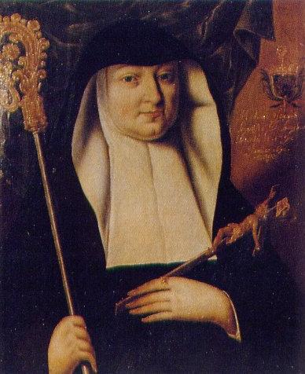

+++
title = "Jeanne-Baptiste de Bourbon"
summary = "Auteur anonyme"
read_more_copy = "Voir la fiche"
categories = ["Fontevristes", "Supérieure", "XVIIe siècle"]
index = ["Jeanne-Baptiste de Bourbon"]
+++

**Titre** : Jeanne-Baptiste de Bourbon

**Auteur principal** : Auteur anonyme

**Date d'exécution** : Années 1670

**Lieu d'exécution** : Abbaye de Fontevraud

**Matériaux/Techniques** : Peinture huile sur toile

**Dimensions** : 80 x 70 cm

**Lieu de conservation actuel** : Saumur

**Lieu de séjour/d'exposition initial** : Abbaye de Fontevraud

**Ordre** : Bénédictin 

**Congrégation** : Fontevriste

**Nom du ou des monastères d'exercice** : Abbaye de Fontevraud

**Nom de la religieuse** : [Jeanne-Baptiste de Bourbon](index:Jeanne-Baptiste-de-Bourbon)

**Statut de la religieuse** : Abbesse

**Commentaires** : Abbesse de Fontevraud de 1637 à 1670.

**Crédits photographiques** : © Ville de Saumur.

**Biographie** : [Jeanne-Baptiste de Bourbon]()

