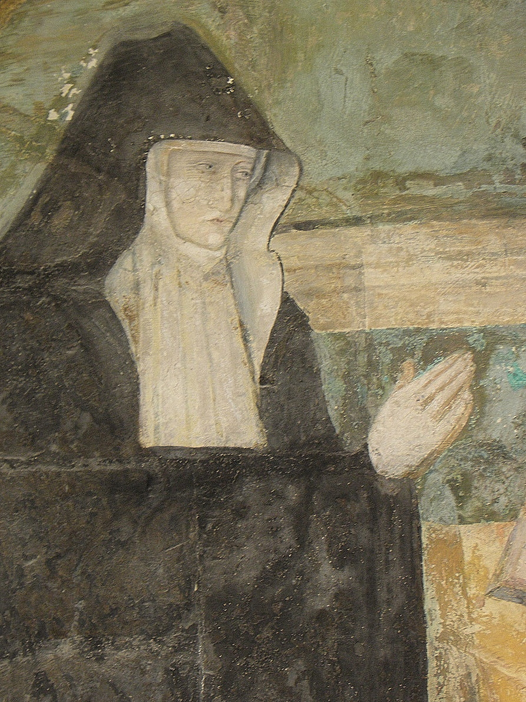

+++
title = "Louise de Bourbon"
summary = "Thomas Pot "
read_more_copy = "Voir la fiche"
categories = ["Fontevristes", "Supérieure", "XVIe siècle"]
index = ["Louise de Bourbon", "Thomas Pot", "Jésus Christ", "Vierge Marie", "Saint Jean", "Sainte Marie-Madeleine", "Soldats"]
+++

**Titre** : Louise de Bourbon

**Auteur principal** : [Thomas Pot](index:Thomas-Pot) 

**Profession** : Peintre

**Date d'exécution** : Vers 1563

**Lieu d'exécution** : Salle capitulaire de Fontevraud, à gauche dans la fresque de la Crucifixion

**Matériaux/Techniques** : Peinture à fresque

**Lieu de conservation actuel** : Salle capitulaire de l'abbaye de Fontevraud

**Lieu de séjour/d'exposition initial** : Salle capitulaire de l'abbaye de Fontevraud

**Ordre** : Bénédictin 

**Congrégation** : Fontevriste

**Nom du ou des monastères d'exercice** : Abbaye de Fontevraud

**Nom de la religieuse** : [Louise de Bourbon](index:Louise-de-Bourbon)

**Statut de la religieuse** : Abbesse

**Autres personnages religieux** : [Jésus Christ](index:Jésus-Christ) ; [Vierge Marie](index:Vierge-Marie) ; [sainte Marie-Madeleine](index:Sainte-Marie-Madeleine) ; [saint Jean](index:Saint-Jean)

**Autres personnages laïcs** : [Soldats](index:Soldats)

**Commentaires** : Abbesse de Fontevraud de 1534 à 1575. C'est la commanditaire des fresques de la salle capitulaire.

**Crédits photographiques** : Lydie Brunetti

**Biographie** : [Louise de Bourbon]()

