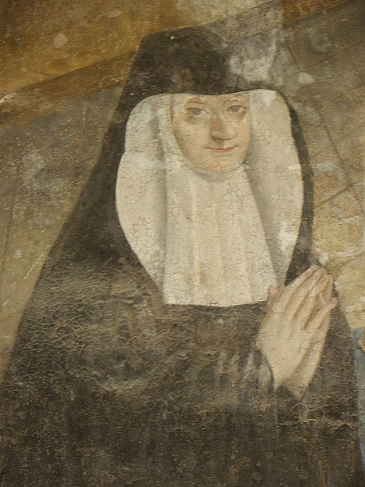

+++
title = "Eléonore de Bourbon"
summary = "Auteur anonyme"
read_more_copy = "Voir la fiche"
categories = ["Fontevristes", "Supérieure", "XVIIe siècle"]
index = ["Eléonore de Bourbon", "Jésus Christ", "Saint Pierre", "Saint Jean", "Apôtres"]
+++

**Titre** : Eléonore de Bourbon

**Auteur principal** : Auteur anonyme

**Profession** : Peintre

**Date d'exécution** : Après 1611

**Lieu d'exécution** : Salle capitulaire de Fontevraud, fresque du lavement des pieds à gauche.

**Matériaux/Techniques** : Peinture à fresque

**Lieu de conservation actuel** : Salle capitulaire de l'abbaye de Fontevraud

**Lieu de séjour/d'exposition initial** : Salle capitulaire de l'abbaye de Fontevraud

**Ordre** : Bénédictin 

**Congrégation** : Fontevriste

**Nom du ou des monastères d'exercice** : Abbaye de Fontevraud

**Nom de la religieuse** : [Eléonore de Bourbon](index:Eléonore-de-Bourbon)

**Statut de la religieuse** : Abbesse

**Autres personnages religieux** : [Jésus Christ](index:Jésus-Christ) ; [saint Pierre](index:Saint-Pierre) ; [saint Jean](index:Saint-Jean) ; [Apôtres](index:Apôtres)

**Commentaires** : Abbesse de Fontevraud de 1575 à 1611. Son image est rajoutée à la fresque après exécution initiale.

**Crédits photographiques** : Lydie Brunetti

**Biographie** : [Eléonore de Bourbon]()

